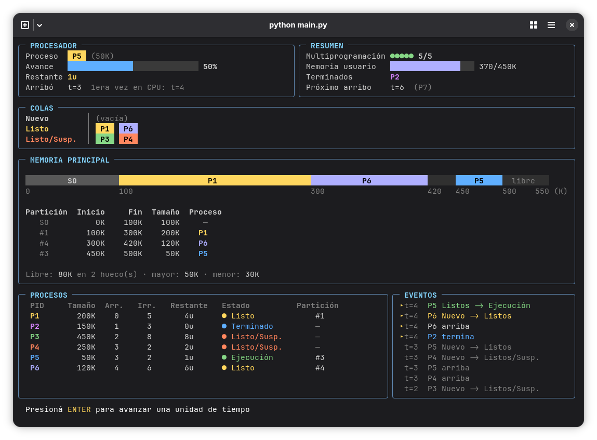

<div align="center">

# Simulador de Planificador de Procesos

**Sistemas Operativos · Trabajo Práctico Integrador · 2026**




</div>

## Ejecución

Desde la carpeta del proyecto:

```bash
python3 main.py
```

<!--## Integrantes

<div align="center">

<table>
    <tr>
        <td align="center" width="200">
            <a href="https://github.com/tomasben">
                <br>
                <b>Benchat, Tomás</b>
            </a><br>
            <sub>Legajo 30221</sub>
        </td>
        <td align="center" width="200">
            <a href="https://github.com/[COMPLETAR]">
                <br>
                <b>[COMPLETAR: Nombre y apellido]</b>
            </a>
            <br>
            <sub>Legajo [COMPLETAR]</sub>
        </td>
            <td align="center" width="200">
            <a href="https://github.com/[COMPLETAR]">
                <br>
                <b>[COMPLETAR: Nombre y apellido]</b>
            </a>
            <br>
            <sub>Legajo [COMPLETAR]</sub>
        </td>
    </tr>
</table>-->
