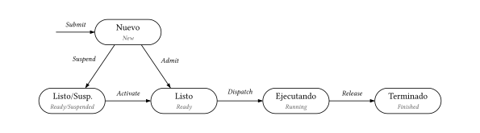
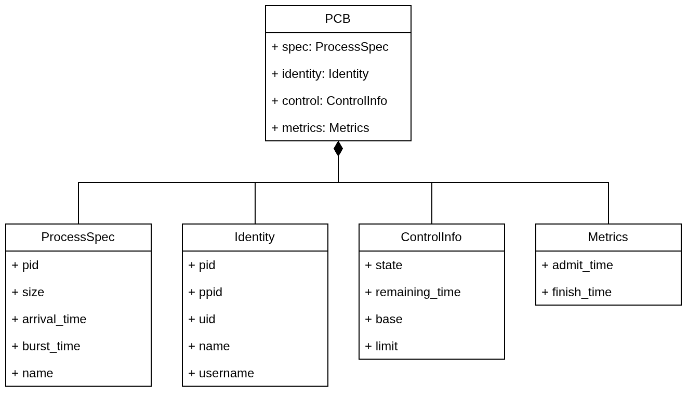

<div align="center">

# Simulador de Planificador de Procesos


</div>

<br>
<br>

> [!NOTE]  
> Toda la interfaz de la terminal, contenida dentro del archivo cli.py, fue creada con inteligencia artificial.

## Funcionamiento

Para no organizar todo dentro del planificador y que este sea el encargado de manejar a la memoria y toda la lógica, se pensó a `Simulator` como la clase que contiene a ambas y las coordina. Para esto, utiliza las funciones que ambas clases exponen. `Memory` permite que se pueda asignar un nuevo espacio para un proceso o que se libere una partición.

`Scheduler` mantiene las colas de procesos nuevos, listos y listo/suspendidos, además del proceso que está en ejecución. Expone operaciones para registrar llegadas (`submit`), admitir procesos (`admit`), suspenderlos (`suspend`), ejecutar el siguiente en la cola de listos (`dispatch`), y también liberar el proceso en ejecución (`release`). Además, tiene una operación para intercambiar al proceso que está ejecutándose y el primero en la cola de listos (`preempt`).


    
La simulación permite avanzar una sola unidad de tiempo o avanzar hasta el siguiente evento donde haya ocurrido una admisión o finalización de un proceso en ejecución, para lo cuál existen las clases `Event` y `EventTy` que registran esto. En cada paso, `Simulator` libera el proceso en ejecución en caso de que haya agotado su tiempo, registra las nuevas llegadas, intenta cargar en memoria a los procesos suspendidos, intenta asignar a los procesos nuevos, luego delega al planificador la decisión de qué proceso ejecutar, y por último avanza el reloj. 


Cada proceso se carga a partir de una especificación de proceso (`ProcessSpec`), que es leida de un archivo .csv, y con la cuál se genera su `PCB` dentro del simulador, en el instante que arriban. Cada PCB tiene asociadas las clases `Identity` y `ControlInfo`, las cuáles reflejan los apartados del PCB vistos en la teória. Además, los PCB también contienen una referencia a la especificación a partir de la cuál fueron generados, y una clase `Metrics` para guardar información estadística relacionada a la ejecución del proceso. Cada uno de estos PCB son almacenados dentro de la tabla de procesos, un diccionario que relaciona los pid con sus respectivos bloques de control, y que vive dentro del simulador.



El resto de estadísticas son derivadas a partir de estas clases.

## Estructura

```
so-tpi
├── main.py              # Punto de entrada
├── cli.py               # Interfaz en la terminal
├── loader.py            # Carga y validación de los procesos
├── simulador.py         # Lógica del simulador
├── style.py             # Secuencias ANSI comunes a todos los archivos
└── tests/
    └── test_memory.py  
```
